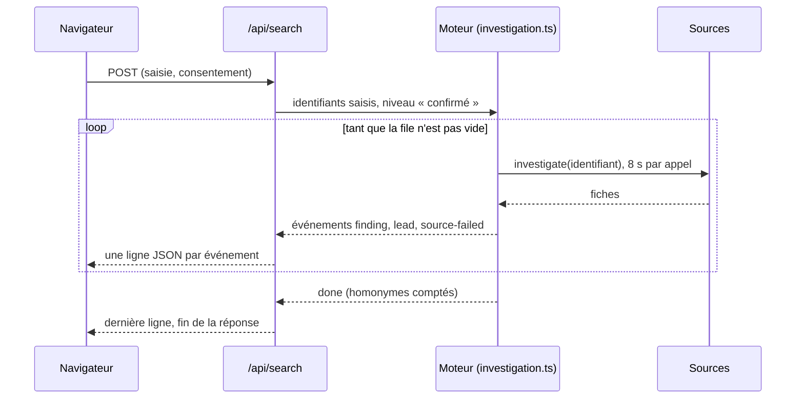
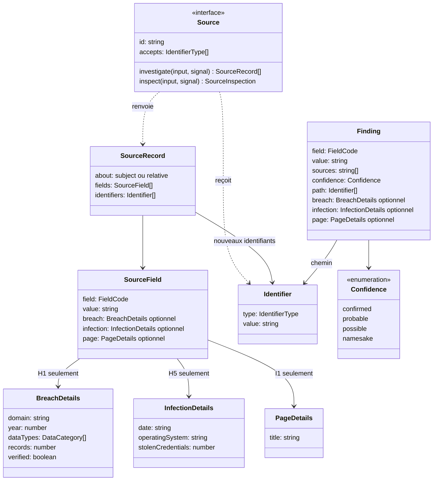

# Architecture de OSINT Open Doors

OSINT Open Doors est un outil de sensibilisation prévu pour les portes ouvertes
du CPNE. Un visiteur teste ses propres informations (email, téléphone, nom et
prénom) et voit dans quelles fuites de données elles apparaissent. Il reçoit
ensuite un plan d'action concret.

## 1. Contexte d'utilisation

- L'application tourne sur un PC de l'école, placé dans un coin privé. Il n'y a
  pas de projection et pas d'accès depuis un appareil personnel.
- Un seul visiteur utilise le poste à la fois. Il confirme avec une case à
  cocher que les données saisies sont les siennes.
- L'application est exécutée localement avec Docker. Le navigateur est lancé en
  mode kiosque et en navigation privée (`--kiosk --incognito http://localhost:3000`).

## 2. Invariants (non négociables)

| Invariant | Mise en œuvre |
| --- | --- |
| Jamais de mot de passe ni de hash affiché | Les mappers des sources appliquent une liste blanche de champs. Le type brut ne sort jamais de l'adaptateur. |
| Pas d'exposition de tiers (homonymes) | Une fiche trouvée par nom n'est détaillée que si elle contient aussi un autre identifiant saisi par le visiteur (téléphone ou email). Sinon, seul un agrégat est affiché (« N fiches portent ce nom »). |
| Valeurs masquées | Les fiches correspondantes sont aussi masquées : `+41 79 ••• •• 42`, « Adresse : présente ». |
| Zéro stockage | Pas de base de données, pas de fichier, pas de `localStorage` ni de cookie contenant des données personnelles. Le conteneur est en `read_only`. |
| Aucun log de données personnelles | Aucun `console.log` d'un input ou d'une réponse d'API. Les messages d'erreur n'incluent pas le corps des réponses. |
| Données personnelles jamais dans l'URL | La recherche se fait uniquement en `POST`. |
| Clés API côté serveur uniquement | Le code serveur se trouve dans `src/server/` et est protégé par `import "server-only"`. |
| Effacement côté poste | Bouton « Effacer et terminer » et reset automatique après une période d'inactivité. |

## 3. Vue d'ensemble

```text
 ┌──────────── Navigateur (PC école, mode kiosque) ─────────────┐
 │  Formulaire + consentement → écran de résultats             │
 │  • POST uniquement, autocomplete="off", pas de localStorage  │
 │  • reset automatique après inactivité                        │
 └───────────────────────────┬──────────────────────────────────┘
                             │ POST /api/search
 ┌───────────────────────────▼──────────────────────────────────┐
 │  Route API Next.js (sans état)                               │
 │  1. valide l'input (zod) + consentement                      │
 │  2. le moteur interroge les sources et rebondit (en direct)  │
 │  3. chaque source : appel HTTP → parse zod → mapper          │
 │     (liste blanche, la réponse brute n'est pas transmise)    │
 │  4. domaine : niveaux de confiance, masquage, score,         │
 │     plan d'action                                            │
 │  5. réponse : métadonnées uniquement                         │
 └───────────────────────────┬──────────────────────────────────┘
                             │
        XposedOrNot  ·  Snusbase  ·  Dehashed  ·  (autres)
```

## 4. Structure du code (Ports & Adapters)

Chaque API externe est une source : un adaptateur qui implémente une
interface commune, le port `Source`. Le reste de l'application ne connaît que
cette interface. Pour changer ou ajouter une API, il suffit d'ajouter un
dossier dans `providers/` et une ligne dans `registry.ts`.

```text
src/
├── app/                          ← Next.js : UI + routes, aussi léger que possible
│   ├── page.tsx                  ← formulaire + consentement
│   ├── api/search/route.ts       ← valide l'input, appelle le service, répond
│   ├── dev/                      ← console de test des sources (npm run dev uniquement, D18)
│   └── api/dev/search/route.ts   ← réponses brutes pour la console (404 en production)
│
├── server/                       ← code serveur uniquement (import "server-only")
│   ├── providers/
│   │   ├── registry.ts           ← liste des sources actives (SOURCES)
│   │   ├── http.ts               ← appel HTTP commun : 404, 429 (quota), erreurs au message fixe
│   │   ├── xposedornot/
│   │   │   ├── index.ts          ← la source : client, schéma et mapper assemblés
│   │   │   ├── client.ts         ← appel HTTP (fetch, timeout, clé)
│   │   │   ├── schema.ts         ← zod : forme de la réponse brute
│   │   │   └── mapper.ts         ← brut → fiches du domaine (liste blanche)
│   │   ├── gravatar/             ← même structure
│   │   ├── hudsonrock/           ← même structure
│   │   ├── github/               ← même structure, jeton optionnel
│   │   ├── tavily/               ← même structure, recherche web, clé obligatoire
│   │   ├── whatsmyname/          ← pseudo sur 569 sites : copie figée de la liste, vérification par site
│   │   ├── snusbase/             ← même structure (prévu)
│   │   └── dehashed/             ← même structure (prévu)
│   │
│   ├── domain/                   ← logique métier pure, sans HTTP, 100 % testable
│   │   ├── types.ts              ← SearchQuery, PersonName, DataCategory
│   │   ├── search-query.ts       ← normalisation, schéma zod de la saisie, identifiants saisis
│   │   ├── fiche-fields.ts       ← codes des champs de la fiche (A1 à J1)
│   │   ├── identifier.ts         ← types d'identifiants et normalisation
│   │   ├── pseudo.ts             ← règle du pseudo rare
│   │   ├── confidence.ts         ← niveaux de confiance et règle de rebond
│   │   ├── finding.ts            ← constats et fusion des doublons
│   │   ├── evidence.ts           ← indices, rattachement, pseudo courant
│   │   ├── source.ts             ← port des sources de l'enquête (Source)
│   │   ├── masking.ts            ← masquage des valeurs
│   │   ├── severity.ts           ← score d'exposition
│   │   └── actions.ts            ← catégories exposées → plan d'action
│   │
│   ├── investigation.ts          ← moteur d'enquête : file, rebonds, événements (T4)
│   ├── dev/                      ← inspection des sources pour la console (D18)
│   └── env.ts                    ← clés d'API lues et validées par zod (seul accès à process.env)
│
├── components/                   ← UI (shadcn/ui + composants maison)
└── tests/
    ├── fixtures/                 ← réponses d'API fictives (jamais de vraies données)
    └── server-only-stub.ts       ← remplace `server-only` dans les tests
```

Chaque test est placé à côté du fichier qu'il teste et porte le même nom avec
`.test.ts` (`finding.ts` et `finding.test.ts`). Vitest est configuré dans
`vitest.config.mts`.

Le port est défini dans le domaine, car le moteur d'enquête en a besoin et le
domaine ne dépend pas des sources.

```ts
// src/server/domain/source.ts
export interface SourceInspection {
  raw: unknown;          // réponse de l'API telle quelle
  parsed: unknown;       // la même après le schéma zod
  records: SourceRecord[];
}

export interface Source {
  id: string;
  accepts: readonly IdentifierType[];
  investigate(input: Identifier, signal: AbortSignal): Promise<SourceRecord[]>;
  inspect(input: Identifier, signal: AbortSignal): Promise<SourceInspection>;
}
```

`inspect` sert uniquement à la console de test (D18). `investigate` appelle
`inspect` et ne garde que `records` : la réponse brute ne quitte la source que
vers la console, jamais vers `/api/search`.

`/api/search` transforme la saisie en identifiants (`queryIdentifiers`) et
lance le moteur d'enquête (`investigation.ts`, T4). Le moteur donne chaque
identifiant aux sources qui acceptent son type, calcule la confiance des
fiches, crée les constats et relance les nouveaux identifiants fiables. Il
émet des événements, que la route envoie au navigateur au fur et à mesure,
une ligne JSON par événement (NDJSON).



Si le visiteur quitte la page, `request.signal` est annulé et le moteur
s'arrête sans lancer de nouvel appel.

Règles du contrat, vérifiées par les tests de `xposedornot/` :

- `investigate` renvoie `[]` pour un type d'identifiant qu'elle n'accepte pas,
  et `[]` si la personne n'est pas trouvée.
- Elle transmet `signal` à `fetch`. Le moteur annule chaque appel après
  8 secondes ; une source qui ignore `signal` bloquerait l'enquête.
- Sur une réponse HTTP 429, ou 403 sans appel restant (GitHub), elle lève
  `SourceQuotaError` : le moteur ne
  l'appelle plus jusqu'à la fin de l'enquête.
- Une source payée à la requête déclare `maxCallsPerInvestigation` : le
  moteur ne l'appelle pas plus souvent dans une même enquête (T5).
- Une source qui vérifie beaucoup de sites déclare `callTimeoutMs`, qui
  remplace les 8 secondes du moteur (WhatsMyName : 25 secondes, T7), et
  `sitesChecked`, le nombre de sites de sa liste (T4).
- En cas d'échec, il lève une erreur au message fixe
  (`xposedornot: HTTP 500`, `xposedornot: invalid response`), sans la saisie
  du visiteur ni le corps de la réponse.

Ajouter une source : créer son dossier dans `providers/` (`schema.ts`,
`mapper.ts`, `client.ts`, `index.ts`, tests et fixtures inventées), puis
l'ajouter à `SOURCES` dans `registry.ts`. Une source qui a besoin d'une clé
d'API n'y est ajoutée que si la clé est configurée (T3).
Pour changer ce qu'une source garde ou affiche, voir le guide
[Flux des données d'une source](guide/05-flux-des-donnees.md).

### Modèle de l'enquête

Le modèle de l'outil d'enquête (T1, T2, T3) est dans `domain/`. XposedOrNot,
le moteur d'enquête et la console `/dev` l'utilisent.



Une source reçoit un identifiant et renvoie des fiches (`SourceRecord`). Un
champ qui décrit un événement porte ses détails dans un type fermé :
`BreachDetails` pour une fuite (H1, T3). Une source ne calcule pas la
confiance : le moteur le fait, parce que lui seul
connaît les identifiants déjà confirmés (T2). Il transforme les fiches en
constats (`Finding`), puis regroupe les doublons.

| Fichier | Rôle |
| --- | --- |
| `fiche-fields.ts` | Codes des champs de la fiche (`A1` à `J1`) et libellés |
| `identifier.ts` | Types d'identifiants, normalisation, clé `TYPE:valeur` des recherches déjà faites |
| `pseudo.ts` | Règle du pseudo rare (6 caractères et une lettre) |
| `confidence.ts` | `assessConfidence`, `isDetailed`, `shouldRebound` |
| `finding.ts` | `Finding`, `findingKey` et `mergeFindings` (fusion des doublons) |
| `evidence.ts` | `isLinkedToConfirmed`, `countHints` (A1, A2, C1), `isCommonPseudo` (T4) |
| `source.ts` | Le port `Source`, les fiches renvoyées, `BreachDetails` et `SourceQuotaError` |

Explication simple, avec des exemples :
[Fonctionnement de l'enquête](guide/06-fonctionnement-de-l-enquete.md).

### Bonnes pratiques appliquées

| Principe | Où | Pourquoi |
| --- | --- | --- |
| Parse, don't validate (zod aux frontières) | `schema.ts`, `route.ts` | Tout ce qui entre (visiteur, API) est vérifié une seule fois. À l'intérieur de l'application, les types sont fiables. |
| Le type brut ne sort jamais de l'adaptateur | `mapper.ts` | Le mot de passe est retiré à cet endroit et ne peut donc pas être affiché par erreur plus loin. Seule exception : la console `/dev`, absente du build de production (D18). |
| Domaine pur | `domain/` | Le domaine n'utilise pas `fetch` et peut être testé avec Vitest sans réseau. |
| Défaillance partielle | `investigation.ts` | Avec `Promise.allSettled` et un délai par appel, les autres sources répondent même si l'une d'elles est en panne. |
| `server-only` | tout `src/server/` | Le build échoue si du code serveur (et donc une clé) se retrouve dans le bundle client. |
| Tests sur fixtures fictives | `tests/fixtures/` | Aucune vraie donnée de fuite n'est versionnée. |

## 5. Stack technique

Les raisons de chaque choix et les alternatives comparées sont dans
[DECISIONS.md](DECISIONS.md). La colonne « Décision » renvoie à l'entrée
correspondante.

| Couche | Technologie | Décision |
| --- | --- | --- |
| Framework | Next.js (App Router) | [D1](DECISIONS.md#d1-framework-front-et-serveur) |
| Langage | TypeScript (mode strict) | [D2](DECISIONS.md#d2-langage) |
| UI | Tailwind CSS, shadcn/ui | [D3](DECISIONS.md#d3-ui-et-style) |
| Animations | Framer Motion | [D4](DECISIONS.md#d4-animations) |
| Validation | zod | [D5](DECISIONS.md#d5-validation-des-données) |
| Tests | Vitest | [D6](DECISIONS.md#d6-tests) |
| Runtime | Node.js 24 LTS | [D16](DECISIONS.md#d16-version-de-nodejs) |
| Exécution | Docker compose, en local | [D7](DECISIONS.md#d7-exécution-et-déploiement) |
| Provider | XposedOrNot (email) ; Snusbase et Dehashed prévus (nom, téléphone) | [D8](DECISIONS.md#d8-sources-de-données-providers) |
| Sources | Un seul port `Source`, une seule liste ; une source sans clé est sautée | [T1](DECISIONS.md#t1-outil-denquête-à-partir-des-propositions-denzo), [T3](DECISIONS.md#t3-xposedornot-sur-le-port-source) |

## 6. Exécution

Le choix de Docker compose en local est expliqué dans
[DECISIONS.md, D7](DECISIONS.md#d7-exécution-et-déploiement).

- Build Docker multi-stage, Next.js en `output: "standalone"`, image
  `node:24-alpine`.
- Le conteneur tourne avec un utilisateur non-root.
- `read_only: true` et `tmpfs` sur `/tmp` : le conteneur ne peut pas écrire sur
  le disque.
- Une seule image et un seul mode : les sources actives sont celles dont la
  clé d'API est configurée (T3).
- `compose.yaml` transmet les variables au conteneur avec
  `env_file: .env.local`. Un `.dockerignore` exclut `.env*`, pour que les
  clés n'entrent jamais dans l'image. Les clés ne sont jamais passées en
  paramètre d'une commande.
- Les clés API sont dans `.env.local`, non versionné. Le fichier `.env.example`
  est versionné et liste toutes les variables attendues, sans valeur. Elles
  sont lues et validées par `src/server/env.ts`, le seul fichier qui lit
  `process.env` ; une erreur ne donne que le nom de la variable. Aucune clé ne
  porte le préfixe `NEXT_PUBLIC_`, qui l'enverrait au navigateur.
- Clés aujourd'hui : `GITHUB_TOKEN` (optionnelle, GitHub marche sans) et
  `TAVILY_API_KEY` (sans elle, la recherche web est sautée).
- Le navigateur du poste est lancé avec
  `--kiosk --incognito http://localhost:3000`.

## 7. Cadre légal

L'application traite des données personnelles en Suisse. La nLPD (en vigueur
depuis le 1er septembre 2023) s'applique, et le RGPD sert de référence
complémentaire. Les mesures prises sont le consentement explicite, la
minimisation des données (métadonnées uniquement, liste blanche) et l'absence
de conservation (pas de stockage, conteneur en lecture seule, pas de logs de
données personnelles).

L'enseignant responsable autorise l'utilisation de toutes les informations
publiques, y compris les bases de données volées rendues publiques. Elles sont
interrogées par des services qui les indexent, jamais téléchargées sur le
poste ([DECISIONS.md, D12](DECISIONS.md#d12-cadre-validé-par-lenseignant)).
Les services payants suivent le budget de [BUDGET.md](BUDGET.md).

## 8. Intégration continue et réglages GitHub

Quatre checks tournent sur chaque pull request : `gitleaks-scan` et
`app-checks` (obligatoires), `markdownlint` et `link check` (si `docs/`
change). Dependabot propose chaque semaine les mises à jour des paquets npm et
des actions. Le ruleset `main-branch` protège `main`.

Le détail (workflows, outils, règles, réglages GitHub, traitement des
alertes) est dans [DEVSECOPS.md](DEVSECOPS.md).
