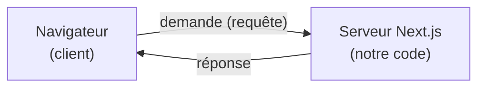
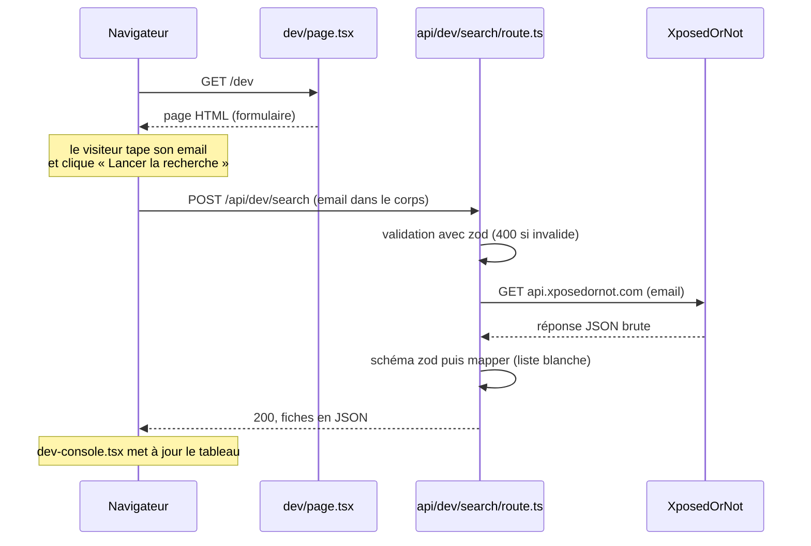
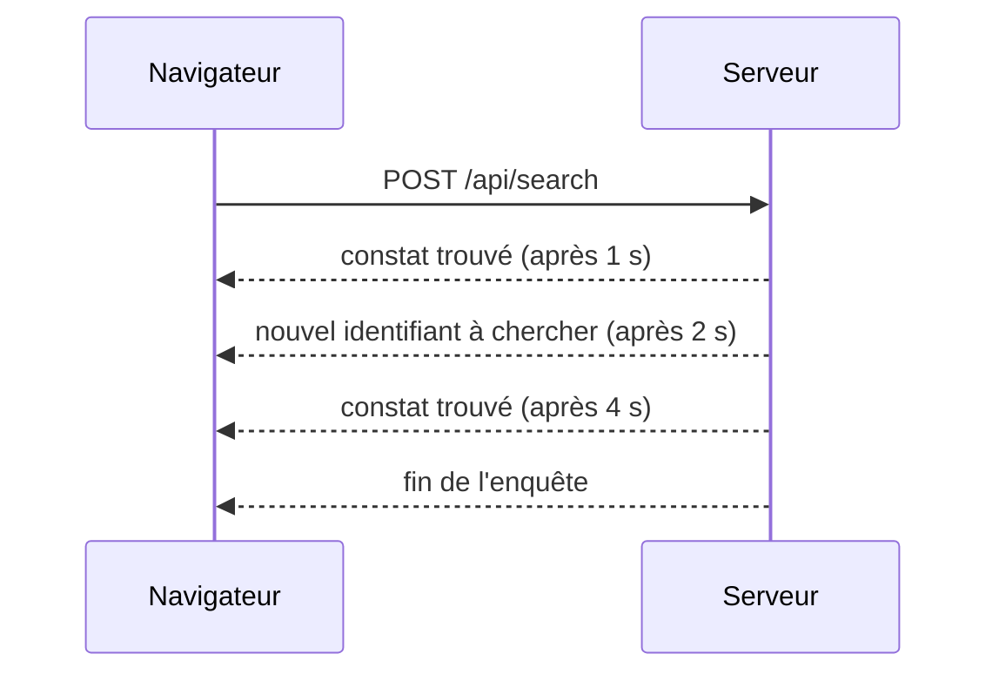

# Comment marche une application web

Cette page explique les bases d'une application web comme la nôtre : qui
parle à qui, comment, et quel fichier du projet répond. Elle ne demande aucune
connaissance préalable. Les termes techniques sont repris dans le
[glossaire](glossaire.md).

## Deux programmes qui se parlent

Une application web, ce sont deux programmes séparés :

- **le client** : le navigateur (Chrome sur le PC du stand). Il affiche les
  pages et envoie ce que le visiteur tape ;
- **le serveur** : le programme Node.js lancé par `npm run dev`. C'est notre
  code de `src/`. Il reçoit les demandes, interroge les sources (XposedOrNot)
  et répond.



Le client et le serveur ne partagent rien : pas de variable, pas de mémoire.
Ils ne communiquent que par messages. Aux portes ouvertes, les deux tournent
sur le même PC, à l'adresse `localhost`, mais ce sont quand même deux
programmes distincts.

On peut comparer avec un restaurant : le client passe une commande, la
cuisine prépare le plat et le renvoie. Le client ne voit jamais la cuisine,
seulement ce qu'elle lui envoie.

## Le message : une requête HTTP

Chaque échange est une **requête**, envoyée par le client, suivie d'une
**réponse**, renvoyée par le serveur. Les deux suivent les règles du
protocole **HTTP**.

Une requête contient :

| Partie | Exemple | Rôle |
| --- | --- | --- |
| Méthode | `GET` ou `POST` | Ce qu'on veut faire |
| Chemin | `/api/search` | À quelle adresse du serveur |
| En-têtes | `Content-Type: application/json` | Des informations sur le message |
| Corps | `{"email":"lea@exemple.ch","consent":true}` | Les données envoyées (seulement avec `POST`) |

Une réponse contient :

| Partie | Exemple | Rôle |
| --- | --- | --- |
| Code | `200` | Le résultat, en un nombre |
| En-têtes | `Cache-Control: no-store` | Ici : « ne garde aucune copie de cette réponse » |
| Corps | une page HTML ou des données JSON | Le contenu |

### GET et POST

- `GET` veut dire « donne-moi ». Le navigateur l'utilise quand on tape une
  adresse : `GET /dev` demande la page de la console.
- `POST` veut dire « voici des données, traite-les ». Le formulaire de
  recherche l'utilise : `POST /api/search` avec l'email dans le corps.

Avec `GET`, les données doivent être écrites dans l'adresse :
`/api/search?email=lea@exemple.ch`. Or l'adresse est gardée dans
l'historique du navigateur et dans les journaux du serveur. Avec `POST`, les
données voyagent dans le corps et l'adresse reste propre. C'est pourquoi la
recherche passe toujours par un `POST` (invariant du projet,
[ARCHITECTURE.md, section 2](../ARCHITECTURE.md#2-invariants-non-négociables)).

### Les codes de réponse

| Code | Sens | Quand chez nous |
| --- | --- | --- |
| `200` | Tout va bien | La recherche a été faite |
| `400` | La requête est invalide | Email mal écrit, consentement absent |
| `404` | Rien à cette adresse | `/dev` dans la version de production |
| `429` | Trop de requêtes | Le quota d'une source est atteint |
| `500` | Erreur du serveur | Une source est en panne |

### Le JSON

Le JSON est le format texte utilisé pour échanger des données. Il ressemble à
un objet JavaScript :

```json
{ "email": "lea@exemple.ch", "consent": true }
```

Le client transforme ses données en texte JSON avant de les envoyer
(`JSON.stringify`), et le serveur les retransforme en objet à la réception
(`request.json()`). Dans l'autre sens, c'est pareil.

## Le routage : quel code répond à quelle adresse

Le **routage** décide quel code répond à une requête, selon son chemin. Next.js
le fait avec les dossiers : l'arborescence de `src/app/` est la liste des
adresses de l'application. C'est ce qu'on appelle l'**App Router**.

```text
src/app/
├── page.tsx                  →  GET  /                 une page
├── dev/page.tsx              →  GET  /dev              une page
├── api/search/route.ts       →  POST /api/search       des données
└── api/dev/search/route.ts   →  POST /api/dev/search   des données
```

Le nom du fichier dit ce qu'il fait :

- **`page.tsx`** est une **page**. Next exécute le composant React et renvoie
  du HTML, que le navigateur affiche. C'est ce qu'on voit en tapant
  l'adresse.
- **`route.ts`** est un **route handler** : une adresse qui renvoie des
  données, pas une page. Il exporte une fonction qui porte le nom de la
  méthode HTTP. Elle reçoit la requête et renvoie une réponse :

  ```ts
  export async function POST(request: Request): Promise<Response> {
    const body = await request.json();          // lire le corps
    // … valider, chercher …
    return Response.json(result, { status: 200 }); // répondre
  }
  ```

  Personne n'ouvre `/api/search` dans le navigateur : c'est le code de la
  page qui l'appelle.

Pour ajouter une adresse, il suffit de créer un dossier et un de ces fichiers.
Il n'y a rien d'autre à configurer.

## Ce qui tourne où

Un fichier du projet ne s'exécute pas forcément au même endroit. C'est le
point le plus important pour la sécurité.

| Code | Où il s'exécute | Exemple |
| --- | --- | --- |
| `route.ts` | Sur le serveur | `src/app/api/search/route.ts` |
| Tout `src/server/` | Sur le serveur. `import "server-only"` le garantit : si du code du navigateur l'importe, le build échoue | Le domaine, les sources |
| `page.tsx` sans directive | Sur le serveur, qui produit le HTML avant de l'envoyer (Server Component) | `src/app/dev/page.tsx` lit la liste des sources |
| Fichier qui commence par `"use client"` | Dans le navigateur, où il réagit aux clics et à la saisie (Client Component) | `src/app/dev/dev-console.tsx` : formulaire, cases à cocher |

Tout le code `"use client"` est envoyé au navigateur du visiteur. N'importe
qui peut le lire avec les outils de développement (touche F12). Une clé d'API
ou un appel à une source ne doit donc jamais s'y trouver : ils restent dans
`src/server/`.

## Une recherche, du clic à l'écran

Voici ce qui se passe avec la console `/dev` (`npm run dev`, puis
`http://localhost:3000/dev`) :



Deux choses à remarquer :

- après le premier chargement, la page ne se recharge plus. Le code client
  envoie la requête en arrière-plan (`fetch`) et ne change que le tableau ;
- notre serveur est aussi un client : pour interroger XposedOrNot, il envoie
  à son tour une requête HTTP à un autre serveur. Le navigateur ne parle
  jamais directement à XposedOrNot.

## Une réponse en plusieurs morceaux

Jusqu'ici, le serveur envoie sa réponse en un seul bloc, une fois tout le
travail fini. Pour une enquête qui rebondit d'une information à l'autre, le
visiteur attendrait longtemps devant un écran vide.

Avec le **streaming**, la réponse reste ouverte et le serveur envoie chaque
résultat dès qu'il le trouve :



Chaque morceau est une ligne de JSON complète. Le navigateur lit les lignes
une par une et affiche chaque résultat dès qu'il arrive. Si le visiteur ferme
la page, la connexion se coupe et le serveur arrête l'enquête. Ce
fonctionnement arrive avec le moteur d'enquête (issue #65, décision T4).

## Mode développement et mode production

| Commande | Mode | Différences |
| --- | --- | --- |
| `npm run dev` | Développement | Le serveur recompile à chaque sauvegarde et affiche des erreurs détaillées. La console `/dev` existe. |
| `npm run build`, puis `npm run start` | Production | Version optimisée, celle des portes ouvertes. `/dev` répond `404`. |

Le détail des commandes est dans [Commandes du projet](02-commandes.md).

## Pour aller plus loin

- [Fichiers du projet](04-fichiers-du-projet.md) : le rôle de chaque fichier,
  avec ces notions en tête.
- [Aperçu du protocole HTTP](https://developer.mozilla.org/fr/docs/Web/HTTP/Overview)
  (MDN, en français).
- Documentation de Next.js sur les pages et les route handlers, installée avec
  le projet : `node_modules/next/dist/docs/01-app/`. Elle correspond à la
  version utilisée, contrairement à certains tutoriels en ligne.
