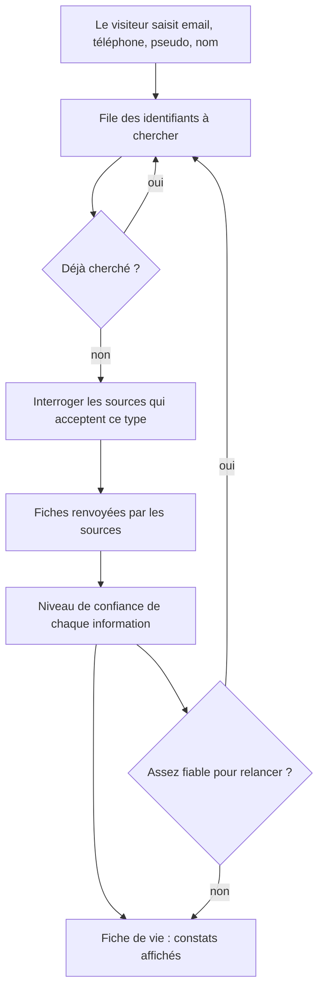
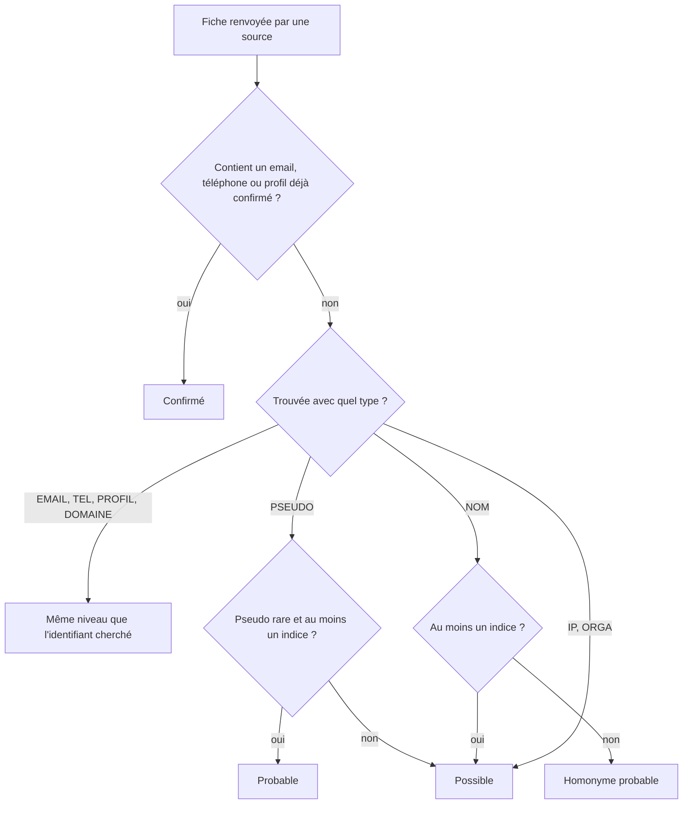
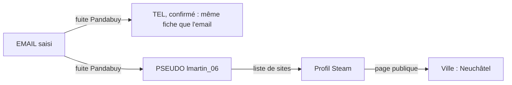

# Fonctionnement de l'enquête

Cette page explique simplement comment l'outil mène une enquête : ce qu'il
cherche, comment il décide qu'une information appartient bien au visiteur et
quand il relance une recherche. Le détail complet est dans
[CADRAGE.md](../CADRAGE.md), les sources dans [SOURCES.md](../SOURCES.md).

État au 2026-11-18 : le modèle de données (issue #63), XposedOrNot sur le
port `Source` (#64) et le moteur d'enquête (#65) sont en place. Deux sources
sont branchées : XposedOrNot et Gravatar. Gravatar donne déjà des rebonds
(pseudo, comptes vérifiés), qui seront cherchés quand des sources de pseudos
et de profils seront branchées (#66, #68).

## L'idée en une phrase

Le visiteur donne une ou plusieurs informations sur lui. L'outil les envoie à
des sources publiques ; chaque nouvelle information trouvée et jugée fiable
est envoyée à son tour, jusqu'à ce que plus rien de nouveau n'apparaisse.

L'enquête s'arrête quand la file est vide. Il n'y a pas de limite de durée ni
de nombre de rebonds : ce sont les règles de rebond qui empêchent de partir
dans tous les sens.

## Les identifiants

Un identifiant est une valeur qu'on peut donner à une source. Chaque valeur
est d'abord nettoyée (normalisée), pour que deux écritures de la même valeur
soient reconnues comme une seule.

| Type | Exemple | Unique ? | Nettoyage |
| --- | --- | --- | --- |
| `EMAIL` | `lea.martin@example.ch` | Oui | Minuscules, espaces retirés, format vérifié |
| `TEL` | `+41791234567` | Oui | Format `+41`, numéros suisses seulement pour l'instant |
| `PSEUDO` | `lmartin_06` | Seulement s'il est rare | Minuscules, `@` retiré |
| `NOM` | `Léa Martin` | Non | Espaces en trop retirés, majuscules gardées |
| `PROFIL` | `https://github.com/lmartin06` | Oui | Adresse `http` ou `https` seulement, `/` final retiré |
| `DOMAINE` | `leamartin.ch` | Oui | Minuscules, `www.` retiré |
| `IP` | `85.1.2.3` | Non (partagée, change) | Format IPv4 ou IPv6 vérifié |
| `ORGA` | `CPNE` | Non | Espaces en trop retirés |

Une valeur invalide est simplement écartée. L'outil ne produit jamais de
message d'erreur qui contiendrait la saisie du visiteur.

Le moteur garde la liste des identifiants déjà cherchés, sous la forme
`TYPE:valeur` (par exemple `EMAIL:lea.martin@example.ch`). Le type fait partie
de la clé : le pseudo `martin` et le nom `martin` sont deux recherches
différentes.

## La fiche de vie

Ce que l'outil cherche à remplir. Chaque champ a un code, utilisé dans le code
et dans les tests (`fiche-fields.ts`).

| Catégorie | Exemples de champs |
| --- | --- |
| A. Identité | A1 nom et prénom, A2 date de naissance, A5 photos de profil |
| B. Coordonnées | B1 emails, B2 téléphones, B3 adresses postales |
| C. Lieux | C1 ville de résidence |
| D. Formation | D1 écoles et formations |
| E. Vie professionnelle | E1 employeurs, E2 registre du commerce |
| F. Présence en ligne | F1 pseudos, F2 comptes |
| G. Activités | G1 sports et clubs, G3 presse |
| H. Exposition et sécurité | H1 fuites, H3 mots de passe exposés, H5 ordinateur infecté |
| I. Traces sur le web | I1 pages qui citent un identifiant |
| J. Entourage | J1 proches : nom, prénom, âge et adresse seulement |

Toutes les valeurs sont masquées par défaut à l'écran et visibles avec un
bouton « œil ».

## Les niveaux de confiance

Une source peut renvoyer la fiche d'un homonyme : une autre personne qui porte
le même nom ou le même pseudo. Chaque information reçoit donc un niveau de
confiance.

| Niveau | Quand | Affiché en détail | Relance une recherche |
| --- | --- | --- | --- |
| Confirmé | La fiche contient aussi un email, un téléphone ou un profil déjà confirmé, ou elle a été trouvée avec un email, un téléphone, un profil ou un domaine confirmé | Oui | Oui |
| Probable | Trouvé par un pseudo rare, avec au moins un indice cohérent (même ville, même photo, même année) | Oui, marqué « probable » | Oui, une seule fois |
| Possible | Trouvé par un pseudo seul, une IP, une organisation, ou un nom avec un indice | Non, compté dans un total | Non |
| Homonyme probable | Trouvé par un nom seul | Non, compté dans un total | Non |

Les saisies du visiteur sont « confirmé » : il a certifié qu'elles sont à lui.

Comment le niveau est choisi (`assessConfidence` dans `confidence.ts`) :

Sauf dans le cas « confirmé », un résultat n'est jamais plus sûr que
l'identifiant qui l'a trouvé : ce qu'un identifiant « probable » trouve est au
mieux « probable ».

## Le pseudo rare

Un pseudo court ou sans lettre (`lea`, `123456`) est porté par beaucoup de
gens : un compte qui le porte n'est pas forcément celui du visiteur. Le
domaine vérifie seulement deux choses : au moins 6 caractères et au moins une
lettre (`pseudo.ts`). Un mot courant comme `thomas` passe ce premier filtre ;
le moteur l'attrape parce qu'il existe sur trop de sites : une source de
pseudos dit combien de sites elle teste, et un pseudo présent sur plus de
10 % d'entre eux n'est pas rare (`evidence.ts`).

## Les rebonds

Un rebond, c'est un nouvel identifiant trouvé qui repart dans la file de
recherche. Exemple :

Chaque information garde ce chemin, pour que l'écran puisse dire « trouvé
grâce à… ».

## Les constats

Un constat est une information de la fiche avec sa provenance : le champ
(`B2`), la valeur, les sources qui l'ont renvoyée, le niveau de confiance et
le chemin.

Plusieurs sources peuvent renvoyer la même information, écrite autrement.
Avant l'affichage, `mergeFindings` (`finding.ts`) regroupe les constats qui
ont le même champ et la même valeur :

| Champ | Deux valeurs sont identiques quand… |
| --- | --- |
| `B1` emails | elles sont égales en minuscules, sans espaces |
| `B2` téléphones | elles donnent le même numéro au format `+41` |
| Autres champs | elles sont égales en minuscules, sans espaces autour |

Le constat fusionné garde la première écriture rencontrée, toutes les sources
(chacune une fois), le niveau de confiance le plus haut et le chemin le plus
court.

Deux valeurs différentes pour le même champ (`Neuchâtel` et `Lausanne` en
ville de résidence) restent deux constats : l'outil ne choisit pas à la place
du visiteur.

Règles (`shouldRebound` dans `confidence.ts`) :

- un `NOM` ne relance jamais de recherche : c'était la principale source de
  faux résultats du premier prototype ;
- un identifiant trouvé chez un proche ne relance jamais de recherche :
  l'outil n'enquête pas sur l'entourage ;
- seuls les niveaux « confirmé » et « probable » relancent ;
- ce qu'un identifiant « probable » trouve ne relance que s'il est
  « confirmé ». Sans cette règle, l'enquête pourrait passer d'un homonyme à
  l'autre.

## Les sources

Toutes les sources respectent le même contrat, l'interface `Source`
(`source.ts`). Le moteur ne connaît que ce contrat : ajouter une source ne
change pas le moteur.

| Élément | Rôle |
| --- | --- |
| `id` | Nom court de la source, repris dans les constats |
| `accepts` | Types d'identifiants que la source sait chercher ; le moteur ne lui envoie que ceux-là |
| `investigate` | Cherche un identifiant et renvoie des fiches |
| `inspect` | Même recherche, avec la réponse brute, pour la console `/dev` |

Une fiche renvoyée (`SourceRecord`) contient les champs trouvés, les nouveaux
identifiants et indique si elle concerne le visiteur ou un proche. La source
ne donne pas de niveau de confiance : c'est le moteur qui le calcule, parce que
lui seul sait quels identifiants sont déjà confirmés. Le moteur transforme
ensuite chaque fiche en constats.

Un champ qui décrit un événement porte aussi ses détails. Pour une fuite (H1),
la valeur est le nom de la fuite, et `breach` donne le site, l'année, les
types de données exposées, le nombre de comptes et si la fuite est vérifiée.
Ce sont des métadonnées : « un mot de passe a fuité », jamais le mot de passe.
Quand deux sources décrivent la même fuite, les détails sont fusionnés.

## En direct

Le moteur n'attend pas la fin de l'enquête pour répondre. Il envoie un
message au navigateur à chaque étape :

| Message | Quand |
| --- | --- |
| `finding` | Un constat « confirmé » ou « probable » est trouvé, ou complété (nouvelle source, chemin plus court) |
| `lead` | Un nouvel identifiant part dans la file de recherche |
| `source-failed` | Une source est en panne (`error`) ou n'a plus de quota (`quota`) |
| `done` | L'enquête est finie ; donne le nombre de fiches « possible » et « homonyme probable », jamais leur contenu |

Une source sans quota n'est plus appelée jusqu'à la fin. Une source en panne
est réessayée pour l'identifiant suivant. Chaque appel a 8 secondes.

Limite connue : si un identifiant n'est confirmé qu'en cours d'enquête, les
fiches déjà traitées ne sont pas recalculées. Elles gardent le niveau qu'elles
avaient au moment où elles sont arrivées.

## Où est le code

| Fichier | Rôle |
| --- | --- |
| `src/server/domain/fiche-fields.ts` | Codes et libellés des champs de la fiche |
| `src/server/domain/identifier.ts` | Types d'identifiants, nettoyage, clé `TYPE:valeur` |
| `src/server/domain/pseudo.ts` | Règle du pseudo rare |
| `src/server/domain/confidence.ts` | Niveaux de confiance et règle de rebond |
| `src/server/domain/finding.ts` | Constats et fusion des doublons |
| `src/server/domain/source.ts` | Contrat commun à toutes les sources, erreur de quota |
| `src/server/domain/evidence.ts` | Indices cohérents, rattachement, pseudo courant |
| `src/server/investigation.ts` | Le moteur : file, rebonds, événements envoyés en direct |

Chaque fichier a ses tests à côté (`*.test.ts`), avec des valeurs inventées.
